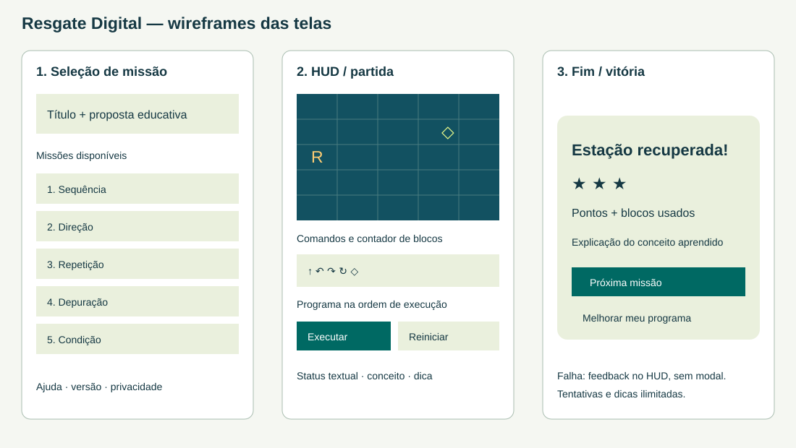
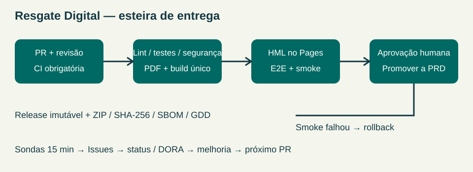

# Resgate Digital — Game Design Document

Versão do GDD: 1.0.0. Data da preparação: 09/10/2026. Repositório: https://github.com/DaviSouza78/resgate-digital. Site: https://davisouza78.github.io/resgate-digital/.

## 1. Premissa

O jogador controla um submarino que resgata estações de conhecimento em um oceano fictício. O jogador monta comandos para guiá-lo, observando a execução e corrigindo erros. O objetivo educativo é facilitar o primeiro contato com lógica de programação sem exigir conhecimentos prévios, leitura de código textual, cadastro ou conexão com a internet.

Público-alvo: iniciantes em tecnologia, sobretudo adolescentes e jovens adultos. Problema: conceitos abstratos como sequência, loop e condição podem dificultar a entrada na programação. O jogo transforma esses conceitos em decisões visíveis, curtas e repetíveis. Não pressupõe equipamento potente ou serviço pago.

## 2. Gênero e plataforma

Puzzle educativo 2D por comandos, single-player, navegador desktop ou mobile. HTML/CSS/JavaScript próprios, arquivos estáticos locais, sem bibliotecas de runtime. Tema visual: exploração subaquática, submarino amarelo, recifes e estações verdes. Sem áudio, personagens de terceiros, física, multiplayer, backend ou mundo aberto.

## 3. Mecânicas-core

Loop principal: ler o objetivo e conceito, montar comandos, executar, observar movimento e feedback, corrigir quando necessário e avançar após a vitória.

Comandos: Avançar move uma casa; Esquerda e Direita giram 90 graus sem deslocamento; Repetir executa 2 a 4 avanços; Se obstáculo vira à esquerda quando a frente está bloqueada e avança quando livre. A direção do submarino define o sentido relativo das curvas.

Vitória: alcançar a estação. Derrota: bater em recife/borda ou terminar as ações antes de alcançar a estação. Tentativas ilimitadas. Reiniciar cancela a execução e mantém os blocos; limpar apaga o programa. Não há vidas, contagem regressiva ou punição por pedir ajuda.

Progressão pedagógica na versão final:

1. Primeiro mergulho: três avanços; aprender sequência.
2. Contorne o recife: ordem e mudança de direção.
3. Menos blocos, mais caminho: usar repetição com limite de blocos.
4. O programa quebrado: observar um erro intencional e depurar.
5. Resgate final: combinar condição, repetição e direção.

Pontuação: 3 estrelas e 300 pontos quando o programa usa até o número-alvo de blocos; 2 estrelas/200 pontos até alvo+2; 1 estrela/100 pontos nos demais programas válidos que vencem. Só o melhor resultado por fase é guardado localmente. As fases podem ser revisitadas ou escolhidas livremente para facilitar demonstração e aprendizagem; a sequência indicada orienta a progressão, sem bloqueio artificial.

Limites: no máximo 30 blocos na definição de fase, 128 ações expandidas e profundidade de repetição até 3. A interface cria apenas repetição simples de avanços. Cada fase tem limite próprio. Estado final não executa comandos adicionais.

Acessibilidade: botões nativos operáveis por teclado, foco visível, texto em português, explicações e dicas, velocidade selecionável, feedback por texto além de cor, layout responsivo e sem rolagem horizontal no teste móvel. O mapa gráfico tem resumo textual de posição/direção/objetivo; a experiência completa com leitor de tela requer avaliação humana adicional, não sendo declarada certificação de acessibilidade.

## 4. Referências e autoria

O conceito combina o exercício educativo de sequenciar comandos em uma grade com uma narrativa própria de resgate subaquático. Não foi reproduzido personagem, imagem, música ou fase de outro jogo. As fontes de requisitos são Avaliação.html (avaliação SENAI fornecida pelo usuário) e Regulamento-Framework-Arcade.pdf (itens 1.2 e 6.3, arquivo fornecido). Esses documentos orientam o escopo e não foram incorporados como ativos no jogo.

Código, CSS, SVG e puzzles criados para este projeto com assistência de OpenAI Codex. Publicação autorizada pelo usuário sob licença MIT; dependências e ferramentas registradas em THIRD_PARTY.md. Uso de IA e revisão humana pendente registrados em AI-USAGE.md.

## 5. Telas e wireframes

Menu/seleção: título, proposta e cinco botões de missão. HUD: grade, direção do submarino, estação, obstáculos, contador de blocos, programa e botões de execução/reinício. Fim: modal de vitória com estrelas, pontos, conceito aprendido, próxima missão e opção de melhorar o programa. Falha: feedback no próprio HUD, permitindo corrigir sem perder os comandos.

Wireframe desktop: topo com nome/ajuda; faixa de missões; coluna esquerda com grade e status; coluna direita com paleta/programa; faixa inferior com aprendizado/dica; rodapé com versão e controles locais. No mobile, as duas colunas se tornam uma coluna vertical. Consulte wireframes.svg e capturas em output/relatorios/.

## 6. Esteira

Entrega atual local: fonte → validação de esquema e soluções → testes/sintaxe → geração do GDD → build de 12 etapas → ZIP e SHA-256 → triagem local → teste de navegador offline.

Esteira implementada: PR/push → CI com validação de sintaxe, testes, cobertura, Gitleaks, auditoria, SBOM e GDD → artefato único → homologação e E2E → promoção do mesmo artefato por azul-verde → smoke → rollback automático se falhar. monitor.yml agenda sondas de 15 minutos e Issues de alerta, com dados reais para /status/. Aprovação de produção é uma configuração do ambiente no GitHub.

Repositório público criado e primeiro ciclo de CI/HML/PRD aprovado pela pipeline. version.json registra SHA Git e identificador do artefato. Doze commits de versão e tags têm atribuição nominal solicitada pelo usuário, três por integrante, com e-mails informados. Os quatro RAs constam em SQUAD.md. Vídeo real legendado e relatório técnico são gerados por scripts; revisões humanas, dez PRs revisados, participação acadêmica e demonstração cronometrada de rollback precisam de evidências próprias.

## 7. Equipe e versões

Lucas: Produto e Game Design (v0.1.0, v0.5.0, v0.9.0). Miguel: Desenvolvimento e Qualidade (v0.2.0, v0.6.0, v0.10.0). Davi: Plataforma e Release (v0.3.0, v0.7.0, v0.11.0). Lucca: SRE e Segurança (v0.4.0, v0.8.0, v1.0.0). Responsabilidade designada pelo planejamento; revisão e contribuição humana são verificadas depois, não presumidas.
